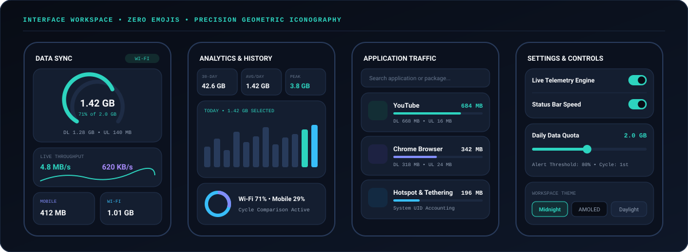
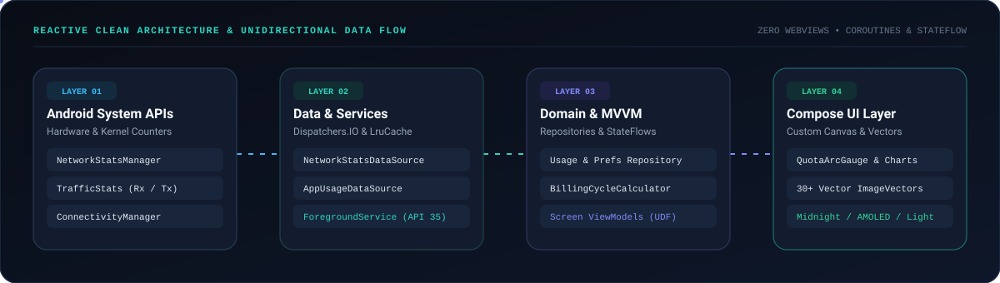

<div align="center">

<!-- Custom Animated Telemetry Hero SVG -->


<br />

<!-- Animated Subtitle Strip -->
<a href="https://github.com/hatakekakashi55/Data_Sync">
  
</a>

<p>
  <a href="https://kotlinlang.org"></a>
  <a href="https://developer.android.com/jetpack/compose"></a>
  <a href="https://developer.android.com"></a>
  <a href="https://github.com/hatakekakashi55/Data_Sync/actions/workflows/android-build.yml"></a>
</p>

<p>
  <a href="https://github.com/hatakekakashi55/Data_Sync/releases/download/v4.0.0/DataSync-v4.0.0-release.apk">
    
  </a>
  <a href="https://github.com/hatakekakashi55/Data_Sync/releases/download/v4.0.0/DataSync-v4.0.0-debug.apk">
    
  </a>
  <a href="https://github.com/hatakekakashi55/Data_Sync/releases/tag/v4.0.0">
    
  </a>
</p>

</div>

---

## Table of Contents

1. [Executive Overview](#executive-overview)
2. [Workspace & Interface Showcase](#workspace--interface-showcase)
3. [Reactive Clean Architecture](#reactive-clean-architecture)
4. [Core Engineering Capabilities](#core-engineering-capabilities)
5. [Screen-by-Screen Specification](#screen-by-screen-specification)
6. [Complete Modular Source Tree](#complete-modular-source-tree)
7. [Technology Stack & Version Catalog](#technology-stack--version-catalog)
8. [Android Permissions & Zero-Telemetry Privacy](#android-permissions--zero-telemetry-privacy)
9. [Installation, Local Build & CI/CD Pipeline](#installation-local-build--cicd-pipeline)

---

## Executive Overview

**Data Sync** (`com.nexussync.datausage`) is a native Android network telemetry, real-time throughput monitor, and carrier quota management application built from the ground up in **Kotlin** and **Jetpack Compose (Material 3)**.

Unlike hybrid WebView wrappers, Data Sync communicates directly with the Android kernel and framework accounting services—`NetworkStatsManager`, `TrafficStats`, `ConnectivityManager`, and `AppOpsManager`—delivering sub-second live speed sparklines, 260-degree quota gauges, interactive 30-day cycle charts, UID-level per-application breakdowns, and an Android 14/15-compliant persistent foreground status bar notification in a **1.5 MB R8-minified binary**.

Every icon across the entire application is rendered from custom 24dp geometric `ImageVector` paths and Android vector drawables—**zero emojis**, zero external icon font bloat, and zero third-party analytics SDKs.

---

## Workspace & Interface Showcase

<div align="center">
  
</div>

---

## Reactive Clean Architecture

<div align="center">
  
</div>

The codebase is strictly partitioned into four decoupled layers following **Clean Architecture + MVVM + Unidirectional Data Flow (`StateFlow`)**:

- **Layer 01 — Android System & Kernel Counters**: Reads monotonic hardware interface counters via `TrafficStats`, historical device & UID buckets via `NetworkStatsManager` (with deterministic `finally { stats.close() }` binder cleanup), active transport/VPN/metered capabilities via `ConnectivityManager`, and runtime access states via `AppOpsManager`.
- **Layer 02 — Data Sources & Foreground Telemetry Service**: Executes historical bucket aggregation on `Dispatchers.IO`, caches rendered native application icons inside a 64-entry `LruCache<String, ImageBitmap>`, persists user configuration reactively in `PreferencesRepositoryImpl`, and runs `DataUsageForegroundService` (`FOREGROUND_SERVICE_TYPE_SPECIAL_USE`) for live status bar updates and daily threshold alerts.
- **Layer 03 — Domain Contracts & MVVM ViewModels**: Defines immutable domain entities (`DataUsageSnapshot`, `LiveSpeedSnapshot`, `DailyUsageEntry`, `AppDataUsage`, `UserPreferences`, `NetworkConnectionInfo`), pure JVM calculation utilities (`DataFormatter`, `BillingCycleCalculator`), and screen-scoped `ViewModel` state holders exposing lifecycle-aware `StateFlow<UiState>`.
- **Layer 04 — Jetpack Compose Material 3 UI**: Renders custom hardware-accelerated `Canvas` charts (`QuotaArcGauge`, `LiveSpeedTelemetryCard`, `UsageBarChart`, `DistributionRingRow`), 30+ bespoke rounded-stroke `ImageVector` icons (`DataSyncIcons`, `SystemIcons`), and four adaptive themes (`Midnight Slate`, `Pure AMOLED`, `Clean Daylight`, `System Default`) with tabular numerals (`tnum`) to eliminate layout jitter during live updates.

---

## Core Engineering Capabilities

| Capability | Architectural Implementation |
| :--- | :--- |
| **260° Daily Quota Arc Gauge** | Custom Compose `Canvas` gauge with outer degree tick marks, smooth `animateFloatAsState` sweep transitions, tabular byte counters, remaining allowance calculation, and automatic semantic color shifting (`Teal` healthy, `Amber` warning threshold, `Rose` quota exceeded). |
| **Real-Time Throughput & Sparkline** | Samples `TrafficStats.getTotalRxBytes()` and `getTotalTxBytes()` deltas against `SystemClock.elapsedRealtime()`, maintaining a 30-point ring buffer rendered as a cubic-bezier gradient area wave alongside session duration and peak download speed. |
| **Cellular & Wi-Fi Interface Split** | Separate directional (`Rx` download / `Tx` upload) and combined accounting for `TYPE_MOBILE` and `TYPE_WIFI`, paired with real-time active transport badges (`WI-FI`, `MOBILE`, `ETHERNET`, `VPN`, `METERED`, `OFFLINE`). |
| **Interactive 30-Day History Chart** | Tap-selectable 30-bar `Canvas` chart with horizontal reference gridlines, instant series switching (`Combined`, `Mobile`, `Wi-Fi`), selected-day inspection callout, 30-day total, daily average, and peak day KPIs. |
| **Traffic Distribution Rings** | Dual-segment Compose `Canvas` donut charts visualizing today's **Interface Split** (Mobile vs Wi-Fi) and **Directional Split** (Downloaded vs Uploaded), plus **Current Cycle vs Previous Cycle** comparison cards. |
| **UID Per-Application Inspector** | Aggregates `NetworkStatsManager.querySummary` across `Today`, `Last 7 Days`, or `This Cycle`; resolves `PackageManager` labels/icons plus special kernel buckets (`Android System OS`, `Hotspot & Tethering`, `Uninstalled Applications`); includes live search and a detail bottom sheet linking directly to Android's system background data controls. |
| **Custom Billing Cycle Engine** | Configurable carrier reset day (`1st` through `28th` of every month) via `BillingCycleCalculator`, computing exact current/previous cycle boundaries, elapsed days, and days remaining. |
| **Status Bar Service & Quota Alerts** | Android 14/15-compliant `DataUsageForegroundService` posting silent `IMPORTANCE_LOW` status bar notifications with monochrome `@drawable/ic_stat_data_sync`, live `DL / UL` throughput, quota progress bar, once-per-day warning notifications (`70% / 80% / 90%`), and `BootCompletedReceiver` auto-start. |
| **Multi-Theme Design System** | Instant runtime switching across **Midnight Slate**, **Pure AMOLED** (`#000000` OLED surface), **Clean Daylight**, and **System Default** via `LocalDataSyncColors` semantic tokens and synchronized edge-to-edge system bar contrast. |

---

## Screen-by-Screen Specification

### 1. Overview (`ui/screens/dashboard/`)
- **Top Telemetry Header**: Brand emblem, monitoring state subtitle, live `ConnectionStatusBadge`, and manual refresh trigger.
- **Contextual Permission Banner**: Automatically appears when `PACKAGE_USAGE_STATS` or Android 13+ `POST_NOTIFICATIONS` is missing, refreshing instantaneously on `Lifecycle.Event.ON_RESUME` upon returning from system settings.
- **Hero Quota Card**: Houses `QuotaArcGauge` plus side-by-side `Downloaded` and `Uploaded` counters.
- **Real-Time Throughput Card**: Displays live Download & Upload rates, cubic-bezier sparkline canvas, peak download rate, and session traffic total.
- **Network Breakdown & Cycle Cards**: Side-by-side Mobile and Wi-Fi cards, Billing Cycle progress card, and Top Active Applications preview list.

### 2. Analytics & History (`ui/screens/analytics/`)
- **30-Day KPI Strip**: Displays `30-Day Total`, `Daily Average`, and `Peak Day` (with date subtitle).
- **Daily Breakdown Card**: Filterable by `Combined`, `Mobile`, or `Wi-Fi`; tapping any of the 30 daily bars updates the inspection header with exact date, total, cellular, and Wi-Fi figures.
- **Distribution & Cycle Comparison**: Dual `DistributionRingRow` visualizations and side-by-side `Current Cycle` vs `Previous Cycle` cards.

### 3. Application Traffic (`ui/screens/apps/`)
- **Search & Controls**: Instant search bar across app names and package IDs, plus header toggles for system UIDs (`Cpu` icon) and manual refresh.
- **Segmented Filter Chips**: Switch time windows (`Today`, `7 Days`, `This Cycle`) and network interfaces (`All Networks`, `Mobile`, `Wi-Fi`).
- **App Detail Bottom Sheet (`AppDetailSheet.kt`)**: Tapping any row opens a `ModalBottomSheet` showing combined consumption, percentage share, Mobile Rx/Tx, Wi-Fi Rx/Tx, and a direct **Manage Background Data in Android Settings** button.

### 4. Settings & Controls (`ui/screens/settings/`)
- **Service & Notifications**: Toggles for `Live Telemetry Engine`, `Status Bar Telemetry`, `Live Speed in Notification`, and `Auto-Start on Boot`.
- **Data Plan & Quota Limits**: Interactive `Daily Data Quota` slider (`0.5 GB – 20.0 GB`) with one-tap preset chips (`1.0`, `1.5`, `2.0`, `3.0`, `5.0`, `10.0 GB`), `Monthly Cycle Plan` slider (`5 – 300 GB`), and `Quota Warning Threshold` selector (`70%`, `80%`, `90%`).
- **Appearance & Billing Cycle**: Theme selector dialog and interactive 28-day grid `BillingDayPickerDialog`.
- **System & Privacy**: Live permission status badges (`Active` / `Grant`), Android System Data Saver status & shortcut, and entry to `AboutScreen`.

### 5. About & Privacy (`ui/screens/about/`)
- Displays build metadata (`BuildConfig.VERSION_NAME` & `VERSION_CODE`), architecture highlights, on-device privacy policy dialog, engineering feedback email launcher, and system wireless settings shortcut.

---

## Complete Modular Source Tree

```text
Data_Sync/
├── .github/workflows/
│   └── android-build.yml                         # CI: Unit tests, Debug/Release APK build & GitHub Release
├── assets/
│   ├── icon.png                                  # High-resolution brand mark
│   ├── readme-hero.svg                           # Animated SVG hero banner & live telemetry HUD
│   ├── readme-architecture.svg                   # Animated SVG Clean Architecture data flow diagram
│   ├── readme-screens-showcase.svg               # Animated SVG 4-screen UI preview
│   └── readme-footer.svg                         # Animated SVG footer bar
├── gradle/
│   ├── libs.versions.toml                        # Centralized Gradle Version Catalog
│   └── wrapper/                                  # Gradle 8.11.1 Wrapper
├── app/
│   ├── build.gradle.kts                          # App module Kotlin DSL & Compose configuration
│   ├── proguard-rules.pro                        # R8 optimization & entry-point keep rules
│   └── src/
│       ├── main/
│       │   ├── AndroidManifest.xml               # App, Activity, SpecialUse FGS & BootReceiver
│       │   ├── java/com/nexussync/datausage/
│       │   │   ├── DataSyncApplication.kt        # Application entry point & channel initialization
│       │   │   ├── MainActivity.kt               # SplashScreen, Edge-to-Edge & Compose host
│       │   │   ├── di/
│       │   │   │   └── AppContainer.kt           # Lightweight singleton dependency container
│       │   │   ├── domain/
│       │   │   │   ├── model/
│       │   │   │   │   ├── AppDataUsage.kt
│       │   │   │   │   ├── DailyUsageEntry.kt
│       │   │   │   │   ├── DataUsageSummary.kt
│       │   │   │   │   ├── LiveSpeedSnapshot.kt
│       │   │   │   │   ├── NetworkConnectionInfo.kt
│       │   │   │   │   └── UserPreferences.kt
│       │   │   │   └── repository/
│       │   │   │       ├── PreferencesRepository.kt
│       │   │   │       └── UsageRepository.kt
│       │   │   ├── data/
│       │   │   │   ├── local/
│       │   │   │   │   └── PreferencesRepositoryImpl.kt
│       │   │   │   ├── repository/
│       │   │   │   │   └── UsageRepositoryImpl.kt
│       │   │   │   └── source/
│       │   │   │       ├── AppUsageDataSource.kt
│       │   │   │       ├── NetworkStatsDataSource.kt
│       │   │   │       ├── NetworkTelemetryDataSource.kt
│       │   │   │       └── PermissionChecker.kt
│       │   │   ├── service/
│       │   │   │   ├── DataUsageForegroundService.kt
│       │   │   │   ├── NotificationHelper.kt
│       │   │   │   └── ServiceController.kt
│       │   │   ├── receiver/
│       │   │   │   └── BootCompletedReceiver.kt
│       │   │   ├── ui/
│       │   │   │   ├── components/
│       │   │   │   │   ├── DistributionRingChart.kt
│       │   │   │   │   ├── LiveSpeedSparkline.kt
│       │   │   │   │   ├── PermissionBanner.kt
│       │   │   │   │   ├── QuotaArcGauge.kt
│       │   │   │   │   ├── SettingRowItem.kt
│       │   │   │   │   ├── SurfaceCard.kt
│       │   │   │   │   └── UsageBarChart.kt
│       │   │   │   ├── icons/
│       │   │   │   │   ├── DataSyncIcons.kt
│       │   │   │   │   └── SystemIcons.kt
│       │   │   │   ├── navigation/
│       │   │   │   │   ├── DataSyncNavHost.kt
│       │   │   │   │   └── ScreenDestination.kt
│       │   │   │   ├── screens/
│       │   │   │   │   ├── about/AboutScreen.kt
│       │   │   │   │   ├── analytics/
│       │   │   │   │   │   ├── AnalyticsScreen.kt
│       │   │   │   │   │   ├── AnalyticsUiState.kt
│       │   │   │   │   │   └── AnalyticsViewModel.kt
│       │   │   │   │   ├── apps/
│       │   │   │   │   │   ├── AppDetailSheet.kt
│       │   │   │   │   │   ├── AppsScreen.kt
│       │   │   │   │   │   ├── AppsUiState.kt
│       │   │   │   │   │   └── AppsViewModel.kt
│       │   │   │   │   ├── dashboard/
│       │   │   │   │   │   ├── DashboardScreen.kt
│       │   │   │   │   │   ├── DashboardUiState.kt
│       │   │   │   │   │   └── DashboardViewModel.kt
│       │   │   │   │   └── settings/
│       │   │   │   │       ├── BillingDayDialog.kt
│       │   │   │   │       ├── SettingsScreen.kt
│       │   │   │   │       └── SettingsViewModel.kt
│       │   │   │   └── theme/
│       │   │   │       ├── Color.kt
│       │   │   │       ├── Theme.kt
│       │   │   │       └── Type.kt
│       │   │   └── util/
│       │   │       ├── DataFormatter.kt
│       │   │       ├── DrawableIconConverter.kt
│       │   │       └── SystemSettingsNavigator.kt
│       │   └── res/
│       │       ├── drawable/                     # Splash emblem & monochrome notification vector
│       │       ├── mipmap-*/                     # Adaptive launcher icons
│       │       ├── values/                       # Strings, Midnight palette & Splash themes
│       │       └── xml/                          # Android 12+ backup & extraction rules
│       ├── test/java/com/nexussync/datausage/
│       │   └── DataFormatterTest.kt              # JVM Unit tests for formatting & billing math
│       └── androidTest/java/com/nexussync/datausage/
│           └── AppContextInstrumentedTest.kt     # AndroidX instrumented package verification
├── build.gradle.kts
├── gradle.properties
├── gradlew
├── gradlew.bat
└── settings.gradle.kts
```

---

## Technology Stack & Version Catalog

| Category | Dependency / Tool | Version |
| :--- | :--- | :--- |
| **Language** | Kotlin (`org.jetbrains.kotlin.android` & `plugin.compose`) | `2.0.21` |
| **Build System** | Android Gradle Plugin (`com.android.application`) / Gradle | `8.7.3` / `8.11.1` |
| **Java Target** | OpenJDK / JVM Bytecode Target | `17` |
| **Android SDK** | `minSdk` / `targetSdk` / `compileSdk` | `24` (Android 7.0) / `35` (Android 15) / `35` |
| **UI Toolkit** | Jetpack Compose BOM (`ui`, `foundation`, `animation`, `material3`) | `2024.12.01` |
| **Navigation** | AndroidX Navigation Compose | `2.8.5` |
| **Architecture** | AndroidX Lifecycle (`viewmodel-compose`, `runtime-compose`) | `2.8.7` |
| **Concurrency** | Kotlinx Coroutines Android | `1.9.0` |
| **Platform Core** | AndroidX Core KTX / Core SplashScreen / Activity Compose | `1.15.0` / `1.0.1` / `1.9.3` |
| **Testing** | JUnit 4 / Kotlinx Coroutines Test / Espresso | `4.13.2` / `1.9.0` / `3.6.1` |

---

## Android Permissions & Zero-Telemetry Privacy

| Permission | Technical Purpose | Data Scope |
| :--- | :--- | :--- |
| `android.permission.PACKAGE_USAGE_STATS` | Required by Android OS to query `NetworkStatsManager` historical cellular, Wi-Fi, and per-UID byte buckets | 100% On-Device |
| `android.permission.ACCESS_NETWORK_STATE` & `ACCESS_WIFI_STATE` | Inspects active network transport, metered state, VPN presence, and Data Saver mode | 100% On-Device |
| `android.permission.FOREGROUND_SERVICE` & `FOREGROUND_SERVICE_SPECIAL_USE` | Runs continuous local status bar telemetry compliant with Android 14/15 foreground service rules | 100% On-Device |
| `android.permission.POST_NOTIFICATIONS` | Posts live status bar throughput drawer updates and daily quota threshold alerts on Android 13+ | 100% On-Device |
| `android.permission.RECEIVE_BOOT_COMPLETED` | Restarts background monitoring automatically on device boot when enabled in Settings | 100% On-Device |

> **Strict Local-First Guarantee:** Data Sync never transmits network statistics, installed package lists, IP addresses, or device identifiers off your phone. There are zero tracking SDKs, zero analytics endpoints, and zero advertisements.

---

## Installation, Local Build & CI/CD Pipeline

### 1. Direct One-Tap APK Installation
Pre-built, signed APKs compiled automatically by GitHub Actions are available on the [**Releases Page (`v4.0.0`)**](https://github.com/hatakekakashi55/Data_Sync/releases/tag/v4.0.0):

- [**DataSync-v4.0.0-release.apk (1.5 MB — Recommended, R8 Minified)**](https://github.com/hatakekakashi55/Data_Sync/releases/download/v4.0.0/DataSync-v4.0.0-release.apk)
- [**DataSync-v4.0.0-debug.apk (10.0 MB — Full Debuggable Build)**](https://github.com/hatakekakashi55/Data_Sync/releases/download/v4.0.0/DataSync-v4.0.0-debug.apk)

> **Upgrade Note:** If an older Capacitor/WebView version of Data Sync is installed on your phone, uninstall it first to prevent signing certificate conflicts before installing `v4.0.0`. Once launched, grant **Usage Access** and **Notification** permissions from the banner or Settings tab.

### 2. Build Locally in Android Studio or CLI
1. **Prerequisites**: Android Studio Ladybug (`2024.2.1`) or newer, **JDK 17**, and **Android SDK Platform 35**.
2. **Clone & Build**:
   ```bash
   git clone https://github.com/hatakekakashi55/Data_Sync.git
   cd Data_Sync

   # Execute JVM unit test suite
   ./gradlew testDebugUnitTest

   # Assemble both Debug and R8-Minified Release APKs
   ./gradlew assembleDebug assembleRelease
   ```
3. **Output Artifacts**:
   - Debug APK: `app/build/outputs/apk/debug/app-debug.apk`
   - Release APK: `app/build/outputs/apk/release/app-release.apk`

### 3. Automated GitHub Actions CI/CD (`.github/workflows/android-build.yml`)
Every push to `main` automatically provisions Temurin JDK 17, runs `./gradlew testDebugUnitTest`, compiles both `assembleDebug` and `assembleRelease`, uploads build artifacts, and publishes updated `.apk` binaries to GitHub Releases.

---

<div align="center">
  
</div>
